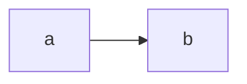

# Design

## Why templates and instances are separate
Templates change through review; runs must not change them.

## Flow
The operator opens a session, the stage contract loads, the stage runs and calls a hosted model, output is written, and the operator reviews it.

